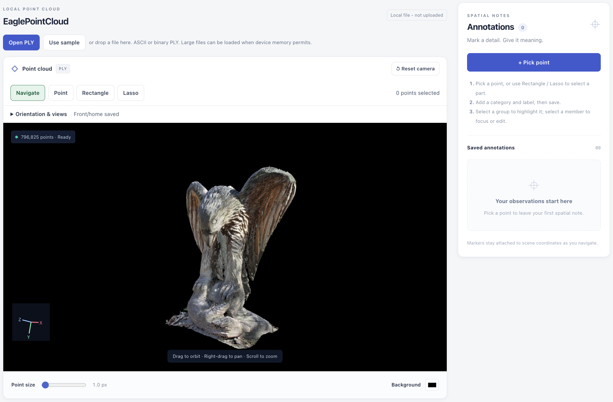
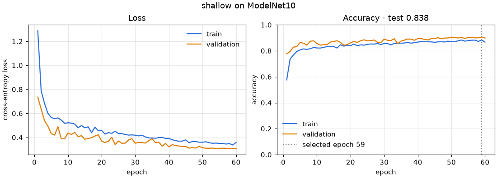
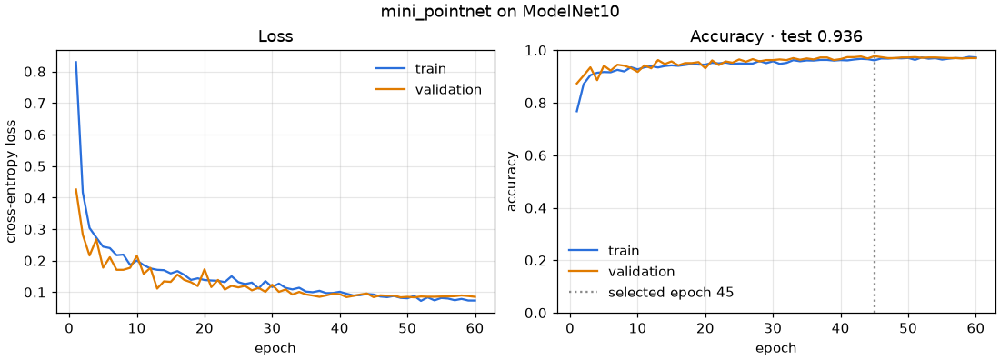

# Neural 3D Data Viewer



An interactive 3D research viewer that started as **DS 7400 Deep Learning HW1**
and is extended by **HW2** with ModelNet10 point-cloud object classification —
a shallow baseline and a Mini-PointNet, trained, monitored and used from the same
application. See [HW2 · ModelNet10 point-cloud classification](#hw2--modelnet10-point-cloud-classification).

Load a colored PLY point cloud, orbit and reorient it, then turn individual points or
whole regions into saved spatial annotations. The viewer, the annotation
workflow and the FastAPI/SQLite backend are all **implemented**.

The same application also opens **3D Gaussian Splat** scenes with
[Spark](https://sparkjs.dev/) (`@sparkjsdev/spark`). One canvas, one camera, two
representations: `point-cloud` and `gaussian-splat`. Exactly one is active at a
time, and the app says which one you are looking at.

## HW2 · ModelNet10 point-cloud classification

**DS 7400 Deep Learning HW2 extends this HW1 Neural 3D Viewer.** The existing
point-cloud viewer (Three.js, annotation, FastAPI/SQLite) and the existing
Gaussian Splat viewer (Spark) are unchanged and still active. HW2 adds
**object classification**: one ModelNet10 class for one complete point cloud,
with a **shallow baseline** and a deeper **Mini-PointNet**, both trained here,
both served by the existing FastAPI backend, and both usable — and trainable —
from a new panel in the existing React application.

Not part of HW2 and not implemented: point-wise segmentation, clean/noisy/partial
classification, and any Gaussian Splat training or optimisation.

### Task and data

- **ModelNet10** (Wu et al., *3D ShapeNets*, CVPR 2015), ten furniture classes:
  `bathtub`, `bed`, `chair`, `desk`, `dresser`, `monitor`, `night_stand`, `sofa`,
  `table`, `toilet`. 4,899 CAD meshes: the **official split** of 3,991 training
  and 908 test meshes is kept.
- **Source and terms.** Downloaded from the Princeton ModelNet page,
  <https://3dvision.princeton.edu/projects/2014/3DShapeNets/ModelNet10.zip>
  (project page <https://modelnet.cs.princeton.edu/>), which provides the data for
  academic research use. The archive is never committed.
- **Automatic preparation** — `python -m app.classification.dataset prepare`
  (and the first GUI training run, if no cache exists):
  1. download with redirects followed (`urllib`, then `curl`/`wget` as fallbacks,
     over HTTPS then HTTP; `MODELNET10_URL` overrides the source);
  2. verify the archive: **473,402,300 bytes**, **SHA-256
     `9d8679435fc07d1d26f13009878db164a7aa8ea5e7ea3c8880e42794b7307d51`**, ZIP CRC;
  3. extract only `ModelNet10/<class>/{train,test}/*.off`, refusing unsafe paths;
  4. validate the ten classes and every per-class train/test file count against
     the official numbers (e.g. chair 889/100, bathtub 106/50);
  5. parse OFF (including ModelNet's merged `OFF490 518 0` header lines,
     polygons fan-triangulated) and draw **1,024 points uniformly on the surface**:
     a triangle with probability proportional to its area, then a uniform point
     inside it. The per-object seed is a CRC of its path, so the result does not
     depend on worker count or order;
  6. **normalise**: subtract the centroid, divide by the largest distance to it
     (unit sphere);
  7. cache everything in one compressed NumPy file (≈ 60 MB) plus a JSON
     manifest; split the official training set **stratified by class, 80/20, seed
     0**, into **3,193 training** and **798 validation** objects.
- On this machine the whole preparation took **39 s** (16 CPU workers).
- Data location: `MODELNET10_DATA_DIR` (default `backend/data/modelnet10/`,
  Git-ignored). Augmentation is applied to **training batches only**: random
  anisotropic scale 0.8–1.25, shift ±0.1, Gaussian jitter σ = 0.01 clipped at
  0.03. No rotation — ModelNet10 objects, including the test split, are upright.

### Models

Both take the same input, a `(batch, 1024, 3)` tensor of normalised points, and
return ten logits. A *shared* layer applies the same weights to every point; it
is written as `nn.Conv1d(kernel_size=1)`, which is exactly a per-point
`nn.Linear`. Global max pooling over the points makes both networks independent
of point order. Code: [`backend/app/classification/models.py`](backend/app/classification/models.py).

| | Shallow baseline | Mini-PointNet (final) |
| --- | --- | --- |
| per-point layers | shared 3→64, activation | shared 3→64→128→256, each with BatchNorm and activation |
| pooling | global max | global max |
| classifier | linear 64→10 | 256→128 (BatchNorm, activation, dropout 0.3) → 10 |
| hidden layers | 1 | 4 (3 shared + 1 in the head) |
| parameters | 906 | 76,362 |

The hidden width `h` (default 64), the activation (`relu`, `leaky_relu`, `gelu`,
`elu`, `tanh`) and dropout are configurable; Mini-PointNet widths scale as
`h → 2h → 4h`, head `4h → 2h → 10`. No input/feature transform networks (T-Nets)
are used: they are not needed for aligned ModelNet10 and would not make the
comparison clearer.

### How a training step works

[`backend/app/classification/training.py`](backend/app/classification/training.py),
`train_one_epoch`:

1. **Forward propagation** — `logits = model(points)`: each point passes through
   the shared hidden layers, max pooling forms one global feature, the head maps
   it to ten scores.
2. **Loss** — `loss = F.cross_entropy(logits, labels)`: softmax over the ten
   scores and the negative log-probability of the true class, averaged over the
   batch.
3. **Backpropagation** — `optimizer.zero_grad()` then `loss.backward()`:
   autograd applies the chain rule backwards through the head, the max pool
   (gradient flows only to the point that won each channel) and the shared layers,
   filling `p.grad = ∂loss/∂p` for every weight. The L2 norm of all gradients is
   recorded every step and shown as `|g|` in the logs.
4. **Optimizer update** — `optimizer.step()`: Adam (weight decay 1e-4) moves
   every weight against its gradient, scaled by the learning rate and Adam's
   running moment estimates; a cosine schedule decays the learning rate to 1% of
   its start over the run.

`model.train()` is set for training batches (BatchNorm uses batch statistics,
dropout is on) and `model.eval()` with `torch.no_grad()` for validation, test
and prediction (BatchNorm uses running statistics, dropout is off). CUDA is used
when available (`--device auto`), CPU otherwise.

### Protocol: train / validation / test

- **Hyperparameter selection on validation only** (experiment `hw2-e01`): the
  learning rate was chosen per model from 0.0005, 0.001, 0.003, 0.01, 0.03 (shallow) and 0.0005, 0.001, 0.003 (Mini-PointNet) with 60 epochs, seed 0,
  batch 32, using `--skip-test`, so these runs never evaluated the test split.
  Best validation accuracy: shallow **0.03** (90.6%),
  Mini-PointNet **0.001** (97.7%). Full table:
  [`docs/hw2-experiments.md`](docs/hw2-experiments.md).
- **Checkpoint selection on validation only**: in every run the epoch with the
  highest validation accuracy (ties: lower validation loss) is kept.
- **Test split read once** per final run, after training, with the selected
  checkpoint (experiment `hw2-e02`, seeds 0, 1, 2). Seed 0 is bundled.

### Results — official ModelNet10 test split (908 objects)

| Model | Parameters | Selected epoch | Best val acc | **Test accuracy** | **Test error** |
| --- | ---: | ---: | ---: | ---: | ---: |
| Shallow baseline (seed 0) | 906 | 59 | 90.6% | **83.8%** | **16.2%** |
| Mini-PointNet (seed 0, bundled) | 76,362 | 45 | 97.7% | **93.6%** | **6.4%** |

**Mini-PointNet lowers the held-out test error from 16.2% to
6.4%** (9.8 percentage points, 61% relative),
i.e. 147 → 58 misclassified test objects. Over seeds 0–2
the test accuracy is 83.85% ± 0.14% (83.8%, 84.0%, 83.7%) for the baseline and 92.77% ± 0.60% (93.6%, 92.3%, 92.4%) for
Mini-PointNet (mean ± standard deviation), so the gap is not a seed effect.

Learning curves (training and validation loss and accuracy per epoch; the dotted
line is the validation-selected epoch):




Test confusion matrices:
[shallow](backend/models/modelnet10/shallow/confusion.png) ·
[Mini-PointNet](backend/models/modelnet10/mini_pointnet/confusion.png).
Per-class test recall (Mini-PointNet / shallow):

| Class | Test objects | Mini-PointNet recall | Shallow recall |
| --- | ---: | ---: | ---: |
| `bathtub` | 50 | 94.0% | 48.0% |
| `bed` | 100 | 100.0% | 91.0% |
| `chair` | 100 | 99.0% | 98.0% |
| `desk` | 86 | 88.4% | 53.5% |
| `dresser` | 86 | 86.0% | 86.0% |
| `monitor` | 100 | 98.0% | 95.0% |
| `night_stand` | 86 | 84.9% | 75.6% |
| `sofa` | 100 | 98.0% | 95.0% |
| `table` | 100 | 88.0% | 78.0% |
| `toilet` | 100 | 97.0% | 95.0% |

In the Mini-PointNet test confusion matrix most errors are between `desk` and
`table` (12 tables predicted as desks) and between `dresser` and `night_stand`
(11 each way) — pairs that share shape and differ mostly in proportion.

Validation accuracy (97.7%) is higher than test accuracy (93.6%): validation
objects come from the official *training* pool, and ModelNet10's test meshes are
a somewhat harder, differently distributed set. Validation was only used to rank
settings and epochs; the test figures are the honest generalisation estimate.

Saved artifacts (all small, all tracked):

| Path | Contents |
| --- | --- |
| `backend/models/modelnet10/shallow/best.pt` | baseline checkpoint (7 KiB) |
| `backend/models/modelnet10/mini_pointnet/best.pt` | final checkpoint (310 KiB) |
| `backend/models/modelnet10/<model>/config.json` | the exact training configuration |
| `backend/models/modelnet10/<model>/history.json` | per-epoch train/val loss and accuracy, gradient norm, learning rate, time |
| `backend/models/modelnet10/<model>/metrics.json` | selected epoch, test accuracy/error/loss, confusion matrix, per-class precision/recall, git SHA, PyTorch version |
| `backend/models/modelnet10/<model>/{curves,confusion}.png` | plots |
| `backend/models/modelnet10/comparison.json` | baseline vs final, plus the three-seed summary |
| `backend/samples/modelnet10/` | 30 test-split objects (3 per class, seed 0) as 1,024-point binary PLY, with both models' predictions |

A checkpoint stores the state dict, the architecture and its configuration,
the class list and the preprocessing description, and is loaded with
`torch.load(weights_only=True)`.

### In the web application

The **ModelNet10 classifier** panel sits under the existing viewer.

- **Classify an object.** Pick a bundled ModelNet10 test sample and **Show
  sample**, or **Upload PLY to classify**; the object opens **in the existing
  point-cloud viewer** (orbit, zoom, orientation controls and the rest unchanged;
  ModelNet samples are turned Z-up). Choose a model — the bundled baseline, the
  bundled Mini-PointNet, or any run you trained in this backend — and press
  **Predict** to see the predicted class, its confidence, the top-3
  probabilities, the true label for a sample, the model's architecture,
  parameter count and configuration, the input's format and point/face counts,
  how it was sampled, and preprocessing and inference time. Loading and error
  states are shown in place. The panel states that **every object is classified
  into one of the ten ModelNet10 classes**, including uploads that are not
  furniture.
- **Prediction uses exactly the training preprocessing**:
  `geometry.points_from_geometry` is the single entry point for training,
  evaluation and inference. A mesh PLY is surface-sampled like a ModelNet mesh; a
  point-cloud PLY is subsampled to 1,024 points (seeded); both are then
  normalised identically. The model runs in `eval()` under `torch.no_grad()`.
  ASCII and binary (little/big-endian) PLY are accepted, up to 64 MiB and
  5,000,000 vertices; malformed, truncated, empty or non-PLY uploads get a clear
  422/413/415 message.
- **Interactive training.** Choose the architecture, **learning rate**,
  **epochs**, **hidden dimension**, **activation** and **batch size**, then
  **Start training**. The run executes in a background thread on the backend —
  the request returns immediately with `202` — and **Cancel** stops it after the
  current batch. Runs are `queued` → `running` → `completed` | `cancelled` |
  `failed`; one trains at a time and up to three wait.
- **Training monitor** (polls once a second): status, phase and device, epoch
  *n* / *N* with a progress bar, the latest **training and validation loss and
  accuracy**, live loss and accuracy curves, the selected epoch and **test
  accuracy once the run completes**, and the error message if it fails. A run
  still active after a page reload is picked up again. A completed run is
  immediately selectable as a prediction model and appears next to the bundled
  **shallow-vs-Mini-PointNet comparison** table and curves.

On a CPU, one Mini-PointNet epoch over the 3,193 training objects takes about
9 s with 8 cores; the shallow baseline about 1 s.

### Backend API

All under `/api/classification`, in
[`backend/app/classification/routes.py`](backend/app/classification/routes.py),
mounted on the existing FastAPI application:

| Method | Path | Purpose |
| --- | --- | --- |
| GET | `/models` | classes, bundled models and completed runs, with test accuracy |
| GET | `/samples` · `/samples/{id}/ply` | bundled ModelNet10 samples and their point clouds |
| GET | `/dataset` | whether ModelNet10 is prepared, split sizes, source and terms |
| POST | `/predict/sample` | `{sample_id, model_id, top_k}` → prediction |
| POST | `/predict/upload?model_id=&filename=&top_k=` | raw PLY body → prediction |
| POST | `/runs` | start a background training run (validated config) → `202` |
| GET | `/runs` · `/runs/{id}` | run list · status with full per-epoch history and final metrics |
| POST | `/runs/{id}/cancel` | cancel a queued or running run |
| GET | `/results` | bundled metrics, histories and the baseline-vs-final comparison |

Run status and history are written to `CLASSIFICATION_RUNS_DIR/<id>/status.json`
(default `backend/data/runs/`, Git-ignored) after every epoch; a run interrupted
by a backend restart is reported as `failed`, not left `running`.

### Reproduce

```bash
source backend/.venv/bin/activate          # see "Run from a clean environment"
cd backend
python -m app.classification.dataset prepare            # download, verify, sample, cache
# validation-only learning-rate selection (repeat per model and rate)
python -m app.classification.training train --model shallow --learning-rate 0.003 --epochs 60 --seed 0 --skip-test --out data/experiments/sweep/shallow_lr0.003
# final runs: the test split is scored once, with the validation-selected epoch
python -m app.classification.training train --model shallow --learning-rate 0.03 --epochs 60 --seed 0 --out data/experiments/final/shallow_seed0
python -m app.classification.training train --model mini_pointnet --learning-rate 0.001 --epochs 60 --seed 0 --out data/experiments/final/mini_pointnet_seed0
python -m app.classification.training evaluate --checkpoint models/modelnet10/mini_pointnet/best.pt   # reload check
python -m app.classification.bundle --baseline data/experiments/final/shallow_seed0 --final data/experiments/final/mini_pointnet_seed0   # copy into models/, write samples
```

The exact Slurm scripts, logs and environment used for the reported numbers are
listed in [`docs/hw2-experiments.md`](docs/hw2-experiments.md).

## Representations

| Representation | Renderer | Opened with | Annotation |
| --- | --- | --- | --- |
| `point-cloud` | Three.js `THREE.Points` | **Open PLY**, **Use sample**, drag and drop | Point, rectangle and lasso, saved to SQLite |
| `gaussian-splat` · local | Spark `SparkRenderer` + `SplatMesh` | **Open Gaussian**, drag and drop | **Not available yet** — see below |
| `gaussian-splat` · hosted | Spark paged `SplatMesh` over a prebuilt `.rad` | **Hosted large scene**, by URL or scene manifest | **Not available yet** — see below |

A Gaussian scene can also carry its **capture path**: load the `cameras.json`
the reconstruction was trained from and you can walk the scene from the inside
with the mouse and <kbd>W</kbd><kbd>A</kbd><kbd>S</kbd><kbd>D</kbd>, held near
the places the training cameras actually stood. See
[Trajectory-constrained exploration](#trajectory-constrained-exploration).

## Visualization data: colored PLY point clouds

- **Bundled synthetic sample — Spectrum Garden.** `spectrum-garden.ply`, ASCII
  PLY, **6,453 colored points** (253,573 bytes), generated entirely from
  analytic grids by [`scripts/generate_sample.py`](scripts/generate_sample.py).
- **Your own files.** **ASCII**, **binary little-endian** and **binary
  big-endian** PLY are all supported. Vertex colors are used when present;
  otherwise points render in a light-blue fallback color.
- **Mesh PLY.** Each original vertex is displayed once as a point and **faces
  are ignored** (the app reports both counts). This is a point-cloud viewer,
  not a surface renderer.
- **Locally opened PLY bytes stay in the browser and are never uploaded to or
  stored on the backend.** Only scene metadata and annotations reach the API;
  the badge **Local file - not uploaded** marks this mode.
- **Optional manual test data.** [`sample-data/`](sample-data/README.md) holds
  two unmodified Open3D PLY files — `EaglePointCloud.ply` (796,825 colored
  points) and `fragment.ply` (196,133 colored points) — for larger real scans.
  They are **not part of the frontend build** and are never served by the app;
  open them with **Open PLY** or drag and drop.

## Visualization data: Gaussian Splat scenes

- **Your own scenes only.** There is no bundled splat sample and no server-side
  conversion: open a local file with **Open Gaussian** or drag it in, or point
  the viewer at a prebuilt Spark `.rad` asset you host yourself.
- **Formats.** Spark 2.2.0 reads `.ply`, `.spz`, `.splat`, `.ksplat` and `.sog`;
  this viewer accepts exactly those five extensions.
  - `.ply` is validated in the browser **before** the scene changes: it must be
    **binary little-endian** PLY 1.0 and must carry either the original 3DGS
    properties (`x/y/z`, `f_dc_0..2`, `opacity`, `scale_0..2`, `rot_0..3`, with
    0, 9, 24 or 45 `f_rest_*`) or the compressed PlayCanvas/SuperSplat layout
    (`packed_position`, `packed_rotation`, `packed_scale`, `packed_color` plus a
    `chunk` element). ASCII PLY, big-endian PLY and list properties are rejected
    with the reason, because Spark's parser does not read them.
  - `.spz`, `.sog`, `.splat` and `.ksplat` are recognised by container magic
    bytes (`.splat`/`.ksplat` are headerless, so only their extension identifies
    them) and are then validated by Spark's own decoder; a decoding failure is
    reported in the viewer.
  - Spark's paged `.rad` level-of-detail container is accepted **by URL only**,
    through **Hosted large scene**. See
    [Large Gaussian scenes](#large-gaussian-scenes) and
    [`docs/hosted-scenes.md`](docs/hosted-scenes.md).
- **A Gaussian PLY and a point-cloud PLY share the `.ply` extension**, so both
  importers route by file **content**, never by extension. A splat PLY opened
  with **Open PLY** is refused with "use Open Gaussian", a point cloud opened
  with **Open Gaussian** is refused with "use Open PLY", and a dropped `.ply`
  goes to whichever renderer its header belongs to.
- **Your splat file never leaves the browser.** Nothing about a Gaussian scene —
  not its bytes, not its identity, not its metadata — is sent to the backend.
  Gaussian scenes are not registered in SQLite at all.
- **No size or splat-count limit is imposed.** A local file is never read into
  one buffer: it is handed to Spark as a stream and decoded chunk by chunk, so
  `arrayBuffer()` is never called on the whole file at any size. The real limit is
  your browser and device memory.
- **Scene identity** follows the file, not its name. At or below 256 MiB and
  2,000,000 splats it is the browser-side SHA-256 of the exact file bytes
  (`splat-<sha256>`), exactly as for PLY point clouds. Above either threshold —
  where hashing every byte would mean materialising the whole file — it is a
  **bounded fingerprint** over the file's name, byte length, last-modified time,
  complete PLY header and three 1 MiB payload windows. The viewer says which one
  it used. Two files differing only outside those windows would share a scene id;
  that only affects which saved camera orientation is offered, because Gaussian
  annotation is disabled and no Gaussian identity reaches the backend.

### Large Gaussian scenes

A 3.13 GB 3DGS PLY (12.6M splats) is a supported input, not an edge case.

- **Local, streamed.** The file is classified from a bounded header prefix, then
  passed to Spark as `stream` + `streamLength` + `fileName`. Spark's loader pulls
  one chunk at a time into its WebAssembly decoder in a worker, so only the
  current chunk is on the main thread. Above 256 MiB or 2,000,000 splats Spark
  also builds a **level-of-detail tree while decoding**, and the renderer draws a
  platform-appropriate splat budget from it instead of all 12.6M splats.
- **Separate progress.** Streaming (bytes read from the file), decoding (bytes
  handed to Spark's decoder) and the level-of-detail build are reported as three
  distinct rows, with **Cancel import** available throughout.
- **Nothing is lost on failure.** A Gaussian scene is decoded *before* the
  displayed scene changes, so cancelling or failing a 3.13 GB import leaves the
  scene you were looking at exactly as it was.
- **Hosted, paged.** For a scene you publish, prebuild the level-of-detail tree
  once with Spark's `build-lod` and host the `.rad` statically. The viewer pages
  it over HTTP — single file with byte ranges, or a chunked `.rad` + `.radc`
  layout that needs no range support — and downloads only the chunks the camera
  needs. A scene manifest at `frontend/public/data/scenes.json` lists published
  scenes without putting a single splat byte in Git. Full instructions, including
  the HTTP Range and CORS requirements:
  [`docs/hosted-scenes.md`](docs/hosted-scenes.md).

### Gaussian Splat viewing — implemented

- Spark `SparkRenderer` and `SplatMesh` on the shared Three.js camera: orbit,
  pan, zoom, automatic fit on load, **Reset camera**, resize and background.
- The **orientation controls work unchanged**, because they move the camera only
  and never rewrite coordinates: arbitrary roll, X/Y/Z up, invert up, the six
  presets, **Save upright** / **Set as front**, and per-file browser storage.
  Splat coordinates stay exactly as the file stores them, so a scene trained in
  a Y-down convention is made upright with these controls, not by a guessed
  transform.
- Loading, ready, empty and error states, an explicit representation badge and
  representation-accurate metadata (splat count, actual format, filename, size).
- A failed splat import leaves the scene you are looking at untouched.

### Trajectory-constrained exploration

Open one Gaussian scene, then **Open camera path** and pick the `cameras.json`
that reconstruction was trained from. The capture path is drawn **inside the
scene**, in the same world space as the splats, and **Explore trajectory** lets
you walk it — constrained to a tube around it, because a Gaussian reconstruction
is only trustworthy where the training cameras looked.

- **Schema.** The original INRIA/Graphdeco `cameras.json`
  (`id`, `img_name`, `width`, `height`, `position`, `rotation`, `fx`, `fy`),
  validated in full before anything is displayed.
- **Coordinates.** `position` is the camera centre and `rotation` is the
  camera-to-world rotation with the camera's OpenCV axes — right, **down**,
  forward — as its **columns**. Three.js looks down **−z** with **+y** up, so
  the viewer negates columns 1 and 2, which is exactly the inverse of
  Graphdeco's own OpenGL↔COLMAP line. Vertical field of view is
  `2·atan(height / (2·fy))`. This was read out of the official implementation,
  not guessed from field names, and is pinned by numeric tests against an
  asymmetric known pose. Full derivation:
  [`docs/camera-trajectories.md`](docs/camera-trajectories.md).
- **Places, not poses.** The real capture is **948 cameras at 158 places** —
  six cube faces share every centre. The panel says
  `948 cameras · 158 trajectory anchors`, and the path is the 158. Grouping is
  by proximity with a tolerance derived from the scene (`extent/1000` = 0.0168
  here), because the six positions differ in their last bits rather than being
  equal. **There is no pose playback**: replaying the 948 would spin on the spot
  six times at every place.
- **The tube.** The camera is held within an adjustable radius of the polyline
  through the anchors. Walking into the boundary *slides* along it instead of
  stopping, the ends are rounded, and where the path crosses itself a windowed
  search keeps you on your own branch. The default radius is half the median gap
  between places and the default speed is twice it, so a scene in millimetres is
  as walkable as one in metres.
- **Walking.** Click the canvas to capture the mouse; <kbd>W</kbd><kbd>A</kbd>
  <kbd>S</kbd><kbd>D</kbd> to move, <kbd>Q</kbd>/<kbd>E</kbd> down and up,
  <kbd>Shift</kbd> to hurry, arrow and page keys to move and look without a
  mouse, <kbd>Esc</kbd> to release the pointer and again to leave. Entering
  keeps the direction you were already facing, and choosing an anchor moves
  where you stand without ever turning you. The panel reports the distance from
  the path, whether the boundary is holding you, and **Return to nearest
  anchor**.
- **Your camera file stays in the browser.** It is read, parsed and dropped —
  never uploaded, never stored in SQLite or `localStorage`. A malformed file
  leaves both the scene and the currently loaded path untouched; opening a
  different Gaussian scene clears the path.
- **Hosted scenes** may declare an optional `trajectoryUrl` in the scene
  manifest, and the viewer loads it with the scene.
- Drawn as a handful of batched Three.js objects whatever the camera count. The
  948 raw frustums are a debug toggle, off by default and not built until asked
  for.

Multi-scene exploration is the **next** milestone and is not part of this one.

### Gaussian Splat annotation — not implemented

Annotation is **disabled, with the reason shown in the UI**, for Gaussian
scenes. Point, rectangle and lasso annotation depends on projecting original
vertices, and a Gaussian scene has no vertices to project; a correct splat hit
test is a separate piece of work. Nothing pretends to work: the annotation
panel, the mode buttons and the point-size control are hidden or disabled, and
the storage badge reads **Annotations paused**. Point-cloud annotation and its
SQLite persistence are unchanged.

## Implemented features

- Direct Three.js point rendering with vertex colors or a fallback color, plus
  adjustable point size and background.
- Orbit, pan, zoom, arbitrary roll, X/Y/Z up choices, a saved upright/front home
  view, six presets (Front/Back/Left/Right/Top/Bottom), and automatic camera
  fitting on load, reset and resize.
- **Open PLY** and **Open Gaussian** pickers plus drag-and-drop, with **Use
  sample** to return to Spectrum Garden. A failed import leaves the previous
  valid scene intact.
- **Open camera path** for a Gaussian scene: the capture path drawn in the
  scene, anchor-by-anchor navigation, and constrained WASD exploration inside a
  tube around it.
- Loading/ready/empty/error states and scene metadata: name, filename, point
  count, file size, PLY encoding, ignored face count, color source and bounds.
- Scenes are keyed by a SHA-256 fingerprint of the exact file bytes, so notes
  follow the file, not its name. Responsive layout; markers use numbers, labels
  and outlines, not color alone.
- **HW2 — ModelNet10 classification:** automatic dataset download and
  preprocessing, a shallow baseline and a Mini-PointNet trained in PyTorch,
  prediction for bundled samples and uploaded PLY files with top-3
  probabilities, interactive background training with learning rate, epochs,
  hidden dimension, activation and batch size, and a live training monitor with
  a baseline-versus-final comparison.

### Annotation — implemented

(HW1 feature, unchanged by HW2. HW2 adds no annotation of its own: ModelNet10
labels come from the dataset, and the classification panel does not write
annotations.)

- **Point:** click near a vertex to place a numbered landmark marker.
- **Rectangle** and **Lasso:** drag an outline to select a region; one region is
  one record, however many points it covers.
- **Replace / Add / Subtract** operations (also Shift and Alt/Option), with a live preview and a cancellable calculation.
- Category, label and optional note, with full create/read/update/delete. Point
  and region records share case-insensitive category + label groups, with
  expand/collapse, highlighting and exact point focus.
- **Select-through:** Rectangle and Lasso include every point projected inside
  the outline, **including points hidden behind others** — not
  visible-surface-only selection.

### Backend/database — implemented

**FastAPI + SQLite** provide health, scene metadata and complete annotation CRUD,
and a **Database connected** badge shows the live mode. If the API is unreachable
the app falls back to a clearly labeled **Local demo mode** backed by
`localStorage`, so viewing and annotating still work without a server.

HW2 adds the `/api/classification/*` routes to the same FastAPI application
(model inference, background training runs, results). Classification does not
use the database: training-run state is a small JSON file per run, and uploads
are processed in memory and never stored. Without a running backend the
classification panel reports that it is unreachable; viewing still works.

## Technology

- **Frontend:** React 19, Vite 7, TypeScript, **Three.js** (`PLYLoader`,
`OrbitControls`), **Spark** `@sparkjsdev/spark` 2.2.0 (MIT, peer dependency
`three >= 0.180.0`), Web Crypto SHA-256, a Web Worker for PLY parsing.
Spark is a normal npm dependency bundled into the production output as a lazily
imported chunk, including its embedded WebAssembly splat parser. **No CDN or
external asset URL is used at runtime**, and the splat chunk is downloaded only
when you first open a Gaussian scene.
- **Backend:** **FastAPI**, Pydantic v2, **SQLAlchemy 2**, **SQLite**, Uvicorn.
- **HW2 deep learning:** **PyTorch** 2.14 (CPU or CUDA), **NumPy**;
  **matplotlib** for the training plots (development dependency). The training
  charts in the browser are plain SVG — no charting library was added.
- **Checks:** ESLint, TypeScript, Playwright, pytest; npm and pip lockfiles.

## Run from a clean environment

Requirements: **Node.js 22.13+**, npm, **Python 3.12+**, a **WebGL2** browser.
Commands start at the repository root; no credentials or GPU needed. Viewing and
prediction need no dataset either (the trained checkpoints and 30 samples are in
the repository); training downloads ModelNet10 (451 MiB) automatically the first
time, or ahead of time with `cd backend && python -m app.classification.dataset prepare`.

**Browser and GPU.** Both representations need **WebGL2**. Spark targets
WebGL2 and does not require WebGPU; if WebGL2 is missing the splat viewer says
so instead of crashing. Splat decoding and sorting run in Spark's own Web
Workers. A software WebGL2 stack (Mesa/SwiftShader) renders splats correctly but
slowly, so real scenes want a GPU.

### Terminal 1: backend

```bash
python3.12 -m venv backend/.venv
source backend/.venv/bin/activate
python -m pip install -r backend/requirements-dev.txt
cd backend
python -m uvicorn app.main:app --reload --host 127.0.0.1 --port 8000
```

Name the 3.12+ interpreter explicitly; a bare `python3` may be an older Python
that cannot install these lockfiles. The lockfile installs the default PyTorch
wheel for your platform; on a CPU-only machine
`pip install --extra-index-url https://download.pytorch.org/whl/cpu -r backend/requirements-dev.txt`
gives the much smaller CPU build of the same version. Optional environment
variables: `MODELNET10_DATA_DIR` (dataset cache), `CLASSIFICATION_RUNS_DIR`
(GUI training runs), `CLASSIFICATION_TRAIN_THREADS` (CPU threads per run). Health check
<http://127.0.0.1:8000/api/health>; SQLite lands in `backend/data/` (Git-ignored).

### Terminal 2: frontend

```bash
cd frontend
npm ci
npm run dev
```

Open <http://127.0.0.1:5173>. Vite proxies `/api` to 8000, so start the backend
first to see **Database connected**.

### Docker Compose

```bash
docker compose up --build
```

Open <http://localhost:8080>: nginx serves the built frontend and proxies
`/api`, and SQLite persists in the `annotations` named volume.

## Verification

Stop any dev servers first: the browser tests start their own API and Vite
instances on a temporary database.

```bash
source backend/.venv/bin/activate
python scripts/generate_sample.py --check
python -m pytest -q backend
python scripts/smoke_backend.py
cd frontend
npm run lint
npm run build
npx playwright install chromium
HW1_PYTHON="$(command -v python)" npm run test:browser
cd .. && python scripts/export_public.py --dry-run
```

`backend/tests/test_classification.py` covers sampling and normalisation, the
OFF and PLY parsers, the model shapes and permutation invariance, backpropagation
and optimizer updates, a training smoke test, checkpoint reloading, every
classification endpoint including invalid uploads, and the training-run
lifecycle (complete, queue, cancel, fail, restart); it uses a generated
stand-in dataset, so no download is needed. `scripts/smoke_backend.py` also
classifies a bundled sample over real HTTP. `frontend/tests/classification.spec.ts`
drives the classification panel end to end against the real bundled
checkpoints; its interactive-training case runs on the real ModelNet10 cache and
is skipped unless `MODELNET10_DATA_DIR` points at a prepared one.

`npm run test:browser` covers both representations, including the Gaussian
format, routing, lifecycle, scene-identity, large-scene and trajectory-exploration
suites. Gaussian rendering is exercised with generated splat fixtures and camera
paths, so no splat asset or camera file download is needed; under software
WebGL2 those cases are slow but pass. Playwright needs an OS with its browser
runtime dependencies, and `node scripts/smoke_static.mjs` checks a backend-less
production build.

`HW1_PORT` and `HW1_API_PORT` move the suite's own Vite and FastAPI instances off
5173/8000 if you already have dev servers there. The paged-RAD cases need a
prebuilt asset, which is deliberately not in this repository, and are skipped
unless you point them at one:

```bash
HW1_RAD_SINGLE=/path/to/scene-lod.rad \
HW1_RAD_CHUNKED=/path/to/chunked/scene-lod.rad \
npm run test:browser
```

Both are served to the browser by a range-capable static host the test starts
itself; see [`docs/hosted-scenes.md`](docs/hosted-scenes.md) for how to build them.

## Future directions — TBD

The page's **Modules** section marks what is active and what is not. Active:
point-cloud viewing with annotation, Gaussian Splat viewing, and (HW2)
ModelNet10 classification with interactive training.

**Not implemented, planned only.** Trajectory-constrained exploration is now active
for a single scene. The next milestone is **JHU-in-3D-style multi-scene
exploration**: several reconstructions selectable in one application, with
navigation guided by the cameras a scene was trained from. After that: point cloud to 3DGS training,
COLMAP multiview reconstruction, VGGT, server-side splat conversion, a scene
gallery, quantitative point-cloud versus Gaussian comparison, and Gaussian
picking and region annotation. None of these exists in the repository today —
there is no reconstruction job, Gaussian training, authentication or cloud
deployment here; the only deep-learning pipeline is HW2's ModelNet10
classifier. Building a `.rad` asset is likewise an
**offline** step you run yourself with Spark's `build-lod`; this repository
hosts nothing and converts nothing.

## Known limitations (HW2)

- **Closed set of ten classes.** Any object, including one that is not
  furniture, is assigned one of the ten ModelNet10 classes; the confidence is a
  softmax score, not a calibrated probability of being in-distribution.
- **Upright, aligned inputs.** Training used no rotation augmentation because
  ModelNet10 is aligned; an uploaded object that is not Z-up or is rotated will
  often be misclassified. The upload must be a whole object, not a scene.
- **Point-cloud uploads are subsampled vertices**, whereas training meshes were
  surface-sampled; a sparse or very non-uniform point cloud therefore differs
  from the training distribution.
- **One training run at a time, in the backend process.** A GUI run competes for
  CPU with inference, and stopping the backend ends it (it is then reported as
  failed). Runs are not distributed and there is no authentication, so the
  training endpoint should not be exposed publicly.
- The reported numbers come from CPU runs on UVA HPC; GPU runs of the same code
  can differ slightly in the last digits. The Docker image change (CPU PyTorch,
  models and samples copied in) has not been built here, because Docker is not
  available on this HPC system.

## Data privacy

No private, clinical, hospital or research data is in this repository or used
by HW2. The only dataset is the public ModelNet10, which is downloaded at run
time and never committed; the 30 bundled samples are 1,024-point resamplings of
public ModelNet10 test meshes. A PLY you open with **Open PLY** still stays in
your browser. A PLY you choose in the classification panel is sent to your own
backend **only when you press Predict**, is parsed and sampled in memory, and is
neither stored nor logged.

## Attribution and AI assistance

- **ModelNet10:** Z. Wu, S. Song, A. Khosla, F. Yu, L. Zhang, X. Tang and
  J. Xiao, "3D ShapeNets: A Deep Representation for Volumetric Shapes", CVPR
  2015; Princeton Vision & Robotics, <https://modelnet.cs.princeton.edu/>,
  provided for academic research use. Not redistributed here except the 30
  small derived samples in `backend/samples/modelnet10/`, with their source files
  named in `index.json`.
- **PointNet:** the Mini-PointNet follows the idea of shared per-point MLPs and
  symmetric max pooling from C. R. Qi, H. Su, K. Mo and L. J. Guibas, "PointNet:
  Deep Learning on Point Sets for 3D Classification and Segmentation", CVPR 2017.
  It is a small re-implementation written for this project in plain PyTorch; no
  code was copied from the official or any other implementation.
- **AI assistance:** Claude Code (Anthropic) assisted with the implementation
  and debugging of HW2 — the dataset pipeline, models, training code, API,
  frontend panel, tests and this documentation. The author reviewed and tested
  the result; the reported metrics come from the training runs recorded in
  [`docs/hw2-experiments.md`](docs/hw2-experiments.md).

## License

**This project** — its own code and the synthetic Spectrum Garden sample — is
released under the **MIT License**: [`LICENSE`](LICENSE).

**Third-party data** is licensed separately: the two PLY files in
`sample-data/` are unmodified redistributions from the Open3D project,
© 2018-2023 www.open3d.org, under the **Open3D MIT License**
([`sample-data/LICENSE`](sample-data/LICENSE)), with source links in
[`sample-data/README.md`](sample-data/README.md). Three.js, React, Vite,
**Spark** (`@sparkjsdev/spark`, MIT, © World Labs), FastAPI, SQLAlchemy and other
dependencies come from their own published packages under their own licenses;
no third-party source is vendored here. PyTorch, NumPy and matplotlib are
likewise installed from their published packages. ModelNet10 is not covered by
this project's MIT license; see [Attribution](#attribution-and-ai-assistance). **No Gaussian Splat asset is committed**:
the browser tests build their splat fixtures analytically in
[`frontend/tests/fixtures/gaussianSplat.ts`](frontend/tests/fixtures/gaussianSplat.ts),
and `.rad`/`.radc` level-of-detail assets are Git-ignored and hosted separately.
